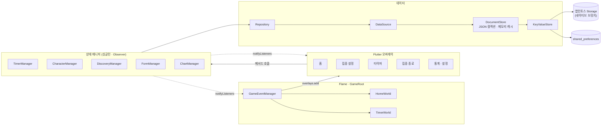
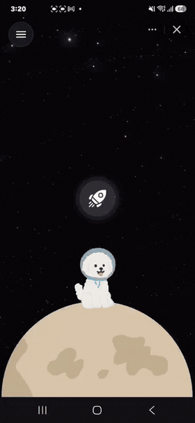

# 대박이 타이머

귀여운 캐릭터와 같이 집중하는 타이머.

https://minion.toss.im/RXaUqzfm (토스앱 필요)

- 앱인토스(Apps in Toss) 미니앱 — Flutter Web 빌드
- 1인 개발

## 기술

- 앱: Flutter 3.29, Dart, Flame(게임 레이어)
- 저장소: 앱인토스 네이티브 Storage 브릿지

## 구조

### 폴더 구조

- `lib/core/observer.dart` — `Observer<T>` 베이스
- `lib/core/storage/` — `KeyValueStore`, `DocumentStore`, 앱인토스/SharedPreferences 어댑터, 환경 선택
- `lib/core/navigation/` — 앱인토스 뒤로가기 브릿지와 앱 내부 back 디스패처
- `lib/core/toss_*.dart` — 햅틱, 안전 영역, 부트 화면의 플랫폼별 구현 (`stub` / `web` 조건부 import)
- `lib/features/data/` — `models/`(JSON 직렬화), `datasources/`, `repositories/`
- `lib/features/presentation/viewmodels/` — 도메인별 `State` + `Manager` (timer, character, discovery, form, chart, audio)
- `lib/features/presentation/views/` — 오버레이와 통계, 캐릭터 설정
- `lib/features/game/` — `GameRoot`(FlameGame), `HomeWorld` / `TimerWorld`, 패럴랙스 별 배경, traveller 스프라이트, `GameEventManager`
- `lib/theme/`, `lib/widgets/tds/` — TDS 토큰과 포팅한 TDS 위젯
- `lib/l10n/` — ARB 번역 파일
- `web/` — 커스텀 `flutter_bootstrap.js`(CanvasKit 로컬 고정), 앱인토스 SDK 번들
- `toss/`, `apps-in-toss.config.ts` — SDK 번들 진입점과 미니앱 배포 설정
- `test/` — 저장소·매니저·내비게이션·위젯 테스트, 인메모리 store 픽스처

## 주요 기능

<table>
<tr>
<td width="300" valign="top"></td>
<td valign="top">

**홈** 캐릭터가 행성 위에서 기다린다. 로켓을 누르면 집중 설정으로 간다.

**집중 설정** 활동(영어, 코딩, 디자인 등)과 목표 시간을 정한다. 최근 활동은 칩으로 바로 고른다.

**집중** 캐릭터가 별밭을 날아간다. 백색소음을 고르고, 멈추거나 그만둘 수 있다. 목표를 채우면 종소리와 진동으로 알린다.

**종료** 활동, 집중 시간, 마친 시각이 요약되고 세션이 기록된다. 바로 한 번 더 시작하거나 기록을 본다.

**통계** 활동별 집중 시간을 일·주·월·년 단위로 본다. 총 시간과 세션 수.

**캐릭터 선택** 함께 집중할 캐릭터를 고른다. 홈과 타이머 월드에 즉시 반영된다.

</td>
</tr>
</table>
